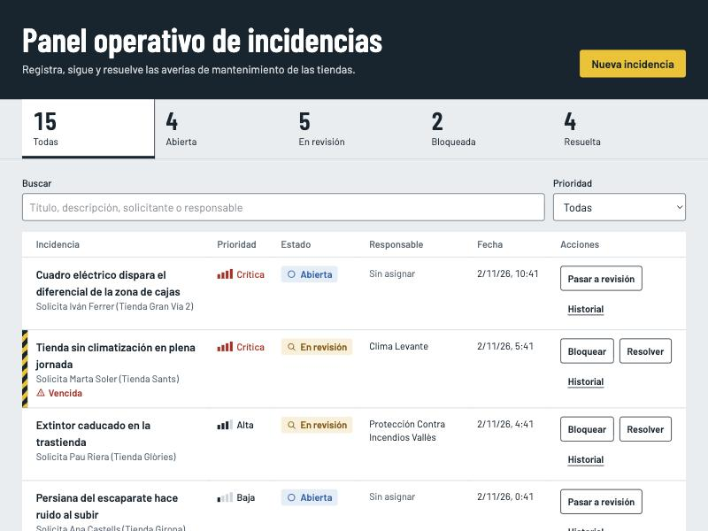

# Panel operativo de incidencias

Aplicación para registrar, seguir y resolver incidencias de mantenimiento, con trazabilidad de cada cambio y un diagnóstico que detecta y corrige de forma segura las inconsistencias de datos.

Es la prueba técnica mid/senior de Optima Retail. Stack: **PHP + Laravel 13, MySQL 8, Inertia + React y Tailwind CSS**.



**Índice:** [Requisitos](#requisitos) · [Instalación](#instalación) · [Ejecución](#levantar-la-aplicación) · [Diagnóstico](#diagnóstico-de-inconsistencias) · [Tests](#tests) · [Decisiones técnicas](#decisiones-técnicas) · [Inconsistencias simuladas](#inconsistencias-simuladas) · [Mapa de requisitos](#mapa-de-requisitos) · [Uso de IA](ai-process/README.md)

## Requisitos

| Herramienta | Versión mínima | Probado con | Por qué |
|---|---|---|---|
| PHP | 8.3 | 8.5.12 | Lo exige Laravel 13. Necesita la extensión `pdo_mysql`. |
| Composer | 2 | 2.11.1 | |
| Node y npm | 20.19 o 22.12 | Node 24.16 | Lo exige Vite 8. |
| MySQL | 8.0.16 | 8.4.13 | Funciones de ventana y `CHECK` aplicados. |

En macOS se pueden instalar con Homebrew:

```bash
brew install php composer node mysql@8.4
```

```bash
brew services start mysql@8.4
```

`mysql@8.4` no se añade al `PATH`: su cliente está en `$(brew --prefix mysql@8.4)/bin/mysql`.

## Instalación

```bash
git clone https://github.com/mikexarau/panel-operativo-incidencias.git
```

```bash
cd panel-operativo-incidencias
```

```bash
composer install
```

```bash
npm ci
```

```bash
cp .env.example .env
```

```bash
php artisan key:generate
```

`.env.example` apunta a MySQL en `127.0.0.1:3306`, con usuario `root`, sin contraseña y con la base `incidents`. Si tu instalación es distinta, ajusta los valores `DB_*` en `.env`.

Crea la base de la aplicación y la de los tests:

```bash
mysql -u root -e "CREATE DATABASE incidents CHARACTER SET utf8mb4 COLLATE utf8mb4_unicode_ci; CREATE DATABASE incidents_test CHARACTER SET utf8mb4 COLLATE utf8mb4_unicode_ci;"
```

## Migrar y cargar datos de ejemplo

```bash
php artisan migrate --seed
```

Crea 15 incidencias: 10 sanas y 5 con [inconsistencias simuladas](#inconsistencias-simuladas). Para volver al estado inicial en cualquier momento:

```bash
php artisan migrate:fresh --seed
```

## Levantar la aplicación

```bash
npm run build
```

```bash
php artisan serve
```

Abre <http://127.0.0.1:8000>. `npm run build` necesita internet la primera vez porque descarga las fuentes tipográficas.

Para desarrollar con recarga automática, `composer run dev` sustituye a los dos comandos anteriores.

> **Pantalla en blanco:** si `composer run dev` se corta a la fuerza puede quedar el archivo `public/hot`, que apunta a un Vite ya apagado. Bórralo con `rm public/hot`.

**Usuario de prueba:** no hay. La autenticación no es obligatoria en la prueba y no se ha implementado. Cada formulario pide "Tu nombre", que queda registrado en el historial y se recuerda en el navegador.

## Diagnóstico de inconsistencias

El comando no modifica nada por defecto: es una simulación que muestra qué se corregiría.

```bash
php artisan incidents:diagnose
```

Resultado con los datos de ejemplo, resumido:

| Incidencia | Regla | Tratamiento | Acción propuesta |
|---|---|---|---|
| 11 | `resolved_without_log` | Automático | Añadir log `status_reconciled` |
| 12 | `status_log_mismatch` | Manual | Una persona decide si manda el estado o el log |
| 13 | `duplicate_log` | Automático | Anular la copia y conservar el original |
| 14 | `duplicate_log` | Manual | Misma transición, pero con otro actor y horas después |
| 15 | `incoherent_log` | Manual | Los datos no permiten deducir qué ocurrió |

Para aplicar las correcciones seguras y registrar el resto para revisión manual. Pide confirmación, salvo que se añada `--force`:

```bash
php artisan incidents:diagnose --fix
```

Con los datos de ejemplo corrige 2 casos y marca 3. Volver a ejecutarlo no cambia nada. Las incidencias marcadas muestran "Revisión de datos" en el panel y el motivo en su detalle.

Las revisiones manuales se cierran con una decisión de una persona, que queda en el historial:

```bash
php artisan incidents:resolve-issue 1 --decision=adopt-log --actor="Responsable de calidad" --reason="Confirmado con la tienda"
```

| Decisión | Efecto | Reglas |
|---|---|---|
| `keep-status` | La incidencia tiene razón: añade un log que recoge su estado | `resolved_without_log`, `status_log_mismatch` |
| `adopt-log` | El último log tiene razón: la incidencia adopta su valor | `resolved_without_log`, `status_log_mismatch` |
| `void-log` | El log es erróneo: lo anula sin borrarlo | `duplicate_log`, `incoherent_log` |
| `accept` | Anomalía histórica conocida: se conserva y deja de reportarse | `duplicate_log`, `incoherent_log` |

El código de salida es `0` si no queda nada pendiente y `1` si quedan hallazgos, de modo que se puede vigilar desde una tarea programada.

En producción, antes de `--fix`, conviene hacer una copia de seguridad con `mysqldump`.

## Tests

Se ejecutan contra MySQL, en `incidents_test`, porque el diagnóstico usa SQL propio de MySQL 8:

```bash
php artisan test
```

La suite es pequeña y a propósito (39 casos, 16 de ellos de la matriz de transiciones). Cubre lo que sería caro que fallara:

- La matriz completa de transiciones.
- El rollback del estado si falla la escritura del log.
- La reapertura con motivo y el rechazo de un estado obsoleto.
- Que los logs no se puedan reescribir ni borrar.
- Filtros y comodines de `LIKE`.
- Que la simulación no escriba nada.
- Que `--fix` no toque estados, sea idempotente y no dé falsos positivos con datos sanos.

## Decisiones técnicas

### Backend

- **Estados centralizados.** `app/Enums/IncidentStatus.php` es la única definición de valores, etiquetas y transiciones. El frontend las recibe en cada incidencia y no duplica la máquina de estados.
- **`string` más `CHECK` en lugar de `ENUM` de MySQL.** Añadir un estado no obliga a reescribir la tabla, y la base de datos sigue rechazando valores inválidos. `old_value` y `new_value` no llevan `CHECK` a propósito: un log conserva lo que ocurrió, aunque sea incoherente, para poder detectarlo.
- **Transacciones.** `ChangeIncidentStatus` actualiza el estado y escribe el log en la misma transacción, con `lockForUpdate` para serializar cambios concurrentes. Además, la petición incluye `expected_status`: si otro operador cambió la incidencia mientras tanto, se rechaza con un mensaje claro en lugar de aplicar una decisión tomada sobre datos antiguos.
- **Claves foráneas `restrict`.** Borrar una incidencia no puede borrar su trazabilidad.
- **Índices comprobados con `EXPLAIN`.** `(status, created_at)`, `(priority, created_at)` y `(created_at)` para el listado, siempre ordenado por fecha, e `(incident_id, created_at)` para el historial. Un primer índice `(status, priority, created_at)` provocaba `filesort` al filtrar solo por estado y se sustituyó.
- **Búsqueda con `LIKE` y comodines escapados.** Es predecible y encuentra palabras parciales. No usa índice, lo que es aceptable a este volumen. Con muchos datos se pasaría a `FULLTEXT`.
- **Logs inmutables.** `IncidentLog` impide modificarlos y borrarlos desde el modelo, y solo admite marcar `voided_at`. Es una protección de aplicación: un `UPDATE` directo en SQL la salta, y por eso existe el diagnóstico.
- **Sin `users`, `cache` ni `jobs`.** Se eliminaron del esqueleto de Laravel para que `migrate` cree solo tablas de la prueba. Sesión y caché usan `file`.

### Ambigüedades del enunciado

| Punto | Decisión |
|---|---|
| `bloqueada` no tiene salida en las transiciones mínimas, y sería un estado sin retorno | Se añade `bloqueada → en revisión`. No se permite pasar directamente a resuelta: debe revisarse antes. |
| "Resuelta no debería volver a abierta sin log explícito" | `resuelta → abierta` registra la acción propia `reopened` y exige motivo. Bloquear también exige motivo. |
| "Vencidas" no tiene campo en el esquema mínimo | Se deriva del SLA por prioridad, sin columna nueva: crítica 4 h, alta 24 h, media 72 h y baja 168 h. Los plazos son una suposición, editable en `IncidentPriority::slaHours()`. |
| `user_name` sin autenticación | El operador se declara en cada formulario y el backend lo valida. No es fiable: en producción saldría de `auth()->user()`. |
| `assigned_to` y "claves foráneas donde corresponda" | Es un nombre libre: no hay tabla de usuarios a la que apuntar. |
| Estados en español en el enunciado y esquema en inglés | Valores internos en inglés (`in_review`) y etiquetas en español, ambos en el enum. |

### Frontend: estado, acciones y refresco

| Pregunta | Respuesta |
|---|---|
| ¿Dónde vive el estado? | Los datos, en el servidor. Los filtros y la incidencia abierta, en la URL (`?status=&priority=&q=&incident=`). En React solo vive qué diálogo está abierto (`Pages/Incidents/Index.jsx`), el texto mientras se escribe y el nombre del operador (`useOperator`). |
| ¿Dónde se dispara la acción? | La navegación, solo en `hooks/useIncidentFilters.js`. Las escrituras, en los formularios con `useForm` (`ChangeStatusDialog`, `CreateIncidentDialog`, `CommentSection`). |
| ¿Cómo se refresca? | Al filtrar, Inertia recarga solo `incidents`, `statusSummary` y `filters`, sin recargar la página. Al abrir una incidencia, solo `selectedIncident`. Tras escribir, el servidor redirige de vuelta y llegan todas las props actualizadas. |

Cubre las cinco interacciones del ejercicio 4, aunque se piden dos: filtro rápido sin recarga, confirmación antes de resolver o bloquear, contadores por estado, resaltado de vencidas y bloqueadas con una banda de peligro, y componentes React para todo ello.

Una decisión de implementación: el nombre del operador se pide dentro de cada formulario y no en la cabecera, porque un `<dialog>` modal deja inerte el resto de la página y no se podría corregir sin cancelar.

### Fuera de alcance

Siguiendo el §11 del enunciado no se incluye autenticación, roles, notificaciones, Docker, deploy ni integraciones. Tampoco editar una incidencia ya creada ni reasignarla. Las revisiones de datos se cierran por consola, no desde la interfaz.

## Inconsistencias simuladas

`database/seeders/InconsistentIncidentSeeder.php` las inserta con `DB::table`, saltándose el dominio, como ocurriría con un `UPDATE` manual, una importación o código antiguo sin transacción.

| # | Incidencia | Qué tiene mal | Tratamiento | Por qué |
|---|---|---|---|---|
| 1 | Fuga de agua en el almacén | Resuelta sin ningún log de resolución | **Crea un log compensatorio** | Nada contradice el estado; solo falta la traza. |
| 2 | Cámara frigorífica con alarma | Bloqueada, pero su último log dice resuelta | **Revisión manual** | Dos fuentes se contradicen. Elegir mal reabriría o cerraría una incidencia real. |
| 3 | Rótulo exterior apagado | La misma transición dos veces, mismo operador, 2 segundos | **Anula la copia** | Es un doble envío evidente y no se pierde información. |
| 4 | Central de incendios | La misma transición dos veces, otra persona, 3 horas | **Revisión manual** | Parece un duplicado, pero puede ser otra acción real. |
| 5 | Persiana metálica | Salta de abierta a resuelta | **Revisión manual** | No se puede saber qué pasó en medio, e inventar pasos falsearía el historial. |

Principios de la corrección:

- **`incidents.status` nunca cambia automáticamente.** El estado dirige la operación real, como enviar a un técnico. Solo lo cambia una persona con `adopt-log`.
- **No se borra ni se reescribe.** Solo se añaden logs. Un duplicado se marca con `voided_at`, se añade una entrada `log_voided` y el historial lo muestra tachado.
- **No se inventan datos.** El log reconstruido usa el actor `system:diagnostic`, su `created_at` es el momento real de la corrección y la hora estimada del suceso va en `metadata.estimated_occurred_at`, sin antedatar nada.
- **Cada corrección es auditable.** Lleva un `run_id` en `metadata`, y cada hallazgo se aplica en su propia transacción, revalidando los datos bajo bloqueo.
- **La cola de revisión no se queda desfasada.** Si un problema desaparece, por ejemplo porque alguien corrige el dato, el siguiente `--fix` cierra su revisión con `no-longer-detected`.

### Consultas de detección

Están en `app/Diagnostics/IncidentConsistencyChecker.php`, un método por regla. Este es el SQL que ejecuta, con los valores de los enums ya resueltos, y se puede lanzar tal cual en un cliente de MySQL.

#### 1. `resolved_without_log`: resuelta sin log de resolución

```sql
WITH last_status_log AS (
    SELECT l.id, l.incident_id, l.new_value, l.created_at,
           ROW_NUMBER() OVER (PARTITION BY l.incident_id ORDER BY l.created_at DESC, l.id DESC) AS recency
    FROM incident_logs l
    WHERE l.action IN ('created', 'status_changed', 'reopened', 'status_reconciled') AND l.voided_at IS NULL
)
SELECT i.id AS incident_id, i.updated_at,
       last_log.id AS last_log_id, last_log.new_value AS last_new_value, last_log.created_at AS last_log_at
FROM incidents i
LEFT JOIN last_status_log last_log ON last_log.incident_id = i.id AND last_log.recency = 1
WHERE i.status = 'resolved'
  AND NOT EXISTS (
      SELECT 1 FROM incident_logs r
      WHERE r.incident_id = i.id
        AND r.action IN ('created', 'status_changed', 'reopened', 'status_reconciled')
        AND r.new_value = 'resolved'
        AND r.voided_at IS NULL
  );
```

**Por qué lo detecta:** el `NOT EXISTS` encuentra incidencias resueltas sin ningún log vigente que las llevara a ese estado. El último log se usa como evidencia: si es posterior a `updated_at`, contradice el estado en lugar de faltar una traza, y el caso pasa a revisión manual.

#### 2. `status_log_mismatch`: el estado no coincide con su último log

```sql
WITH last_status_log AS (
    SELECT l.id, l.incident_id, l.new_value, l.created_at,
           ROW_NUMBER() OVER (PARTITION BY l.incident_id ORDER BY l.created_at DESC, l.id DESC) AS recency
    FROM incident_logs l
    WHERE l.action IN ('created', 'status_changed', 'reopened', 'status_reconciled') AND l.voided_at IS NULL
)
SELECT i.id AS incident_id, i.status, i.updated_at,
       last_log.id AS last_log_id, last_log.new_value AS last_new_value, last_log.created_at AS last_log_at
FROM incidents i
LEFT JOIN last_status_log last_log ON last_log.incident_id = i.id AND last_log.recency = 1
WHERE NOT (last_log.new_value <=> i.status)
  AND NOT (i.status = 'resolved' AND NOT EXISTS (
      SELECT 1 FROM incident_logs r
      WHERE r.incident_id = i.id
        AND r.action IN ('created', 'status_changed', 'reopened', 'status_reconciled')
        AND r.new_value = 'resolved'
        AND r.voided_at IS NULL
  ));
```

**Por qué lo detecta:** `ROW_NUMBER` localiza el último log de estado vigente y se compara con la incidencia. `<=>` es la comparación segura con nulos, así que también detecta incidencias sin ningún log. La segunda condición excluye los casos de la regla 1 para no informar dos veces del mismo problema.

#### 3. `duplicate_log`: log duplicado

```sql
WITH ordered AS (
    SELECT l.id, l.incident_id, l.action, l.old_value, l.new_value, l.user_name, l.created_at,
           LAG(l.id) OVER w AS prev_id,
           LAG(l.action) OVER w AS prev_action,
           LAG(l.old_value) OVER w AS prev_old,
           LAG(l.new_value) OVER w AS prev_new,
           LAG(l.user_name) OVER w AS prev_user,
           LAG(l.created_at) OVER w AS prev_at
    FROM incident_logs l
    WHERE l.action IN ('created', 'status_changed', 'reopened', 'status_reconciled') AND l.voided_at IS NULL
    WINDOW w AS (PARTITION BY l.incident_id ORDER BY l.created_at, l.id)
)
SELECT id, incident_id, old_value, new_value, user_name, prev_id, prev_user,
       TIMESTAMPDIFF(SECOND, prev_at, created_at) AS seconds_apart
FROM ordered
WHERE action <=> prev_action AND old_value <=> prev_old AND new_value <=> prev_new;
```

**Por qué lo detecta:** tras un `abierta → en revisión`, otro log idéntico consecutivo es imposible en un flujo normal, porque la incidencia ya no está abierta. Solo se anula automáticamente con el mismo actor y una separación de 5 segundos o menos (`DOUBLE_SUBMIT_SECONDS`).

#### 4. `incoherent_log`: log incoherente

```sql
WITH ordered AS (
    SELECT l.id, l.incident_id, l.action, l.old_value, l.new_value, l.user_name, l.created_at,
           LAG(l.id) OVER w AS prev_id,
           LAG(l.action) OVER w AS prev_action,
           LAG(l.old_value) OVER w AS prev_old,
           LAG(l.new_value) OVER w AS prev_new,
           LAG(l.user_name) OVER w AS prev_user,
           LAG(l.created_at) OVER w AS prev_at
    FROM incident_logs l
    WHERE l.action IN ('created', 'status_changed', 'reopened', 'status_reconciled') AND l.voided_at IS NULL
    WINDOW w AS (PARTITION BY l.incident_id ORDER BY l.created_at, l.id)
)
SELECT id, incident_id, action, old_value, new_value, prev_id, prev_new,
       CASE
           WHEN new_value IS NULL OR new_value NOT IN ('open', 'in_review', 'blocked', 'resolved') THEN 'value_out_of_catalog'
           WHEN old_value <=> new_value THEN 'no_op'
           WHEN action = 'status_changed' AND old_value = 'resolved' AND new_value = 'open' THEN 'implicit_reopen'
           WHEN action <> 'created' AND (COALESCE(old_value, ''), new_value) NOT IN (('open', 'in_review'), ('in_review', 'blocked'), ('in_review', 'resolved'), ('blocked', 'in_review'), ('resolved', 'open')) THEN 'forbidden_transition'
           WHEN prev_id IS NOT NULL AND NOT (old_value <=> prev_new) THEN 'broken_chain'
       END AS problem
FROM ordered
WHERE action IN ('created', 'status_changed', 'reopened')
  AND NOT (action <=> prev_action AND old_value <=> prev_old AND new_value <=> prev_new)
HAVING problem IS NOT NULL;
```

**Por qué lo detecta:** comprueba cada log contra el catálogo y la máquina de estados, y contra el log anterior: su `old_value` debe coincidir con el `new_value` previo. Detecta valores inválidos, cambios sin efecto, reaperturas sin la acción explícita, transiciones prohibidas y cadenas rotas. Las reconciliaciones quedan fuera porque son compensatorias por definición, y los duplicados ya los informa la regla 3.

## Mapa de requisitos

| Enunciado | Dónde está |
|---|---|
| §3 Pantalla principal | `resources/js/Pages/Incidents/Index.jsx` y `resources/js/Components/incidents/` |
| §3 CSS ordenado | Tokens y clases base en `resources/css/app.css`, y utilidades de Tailwind en los componentes |
| §4 Migraciones, FK e índices | `database/migrations/` |
| §4 Estados centralizados | `app/Enums/IncidentStatus.php` |
| §4 Transiciones coherentes y transacciones | `app/Actions/Incidents/ChangeIncidentStatus.php` |
| §5 Crear con validación | `app/Http/Requests/StoreIncidentRequest.php` y `app/Actions/Incidents/CreateIncident.php` |
| §5 Filtros por estado, prioridad y texto | `app/Http/Requests/ListIncidentsRequest.php` y `Incident::scopeFilter` |
| §5 Historial y comentarios | `app/Http/Resources/IncidentDetailResource.php`, `HistoryTimeline.jsx`, `CommentSection.jsx` |
| §5 Errores claros | `lang/es/validation.php` y `app/Exceptions/InvalidStatusTransition.php` |
| §6 Interacción de frontend | `hooks/useIncidentFilters.js`, `StatusSummary.jsx`, `ChangeStatusDialog.jsx` |
| §7 Datos inconsistentes | `database/seeders/InconsistentIncidentSeeder.php` |
| §7 Detección y corrección | `app/Diagnostics/` y `app/Console/Commands/` |
| §7 Simulación previa | `php artisan incidents:diagnose`, sin `--fix` |
| §8 Uso de IA | [`ai-process/README.md`](ai-process/README.md) |
| §9 `.env.example` sin credenciales | [`.env.example`](.env.example) |
