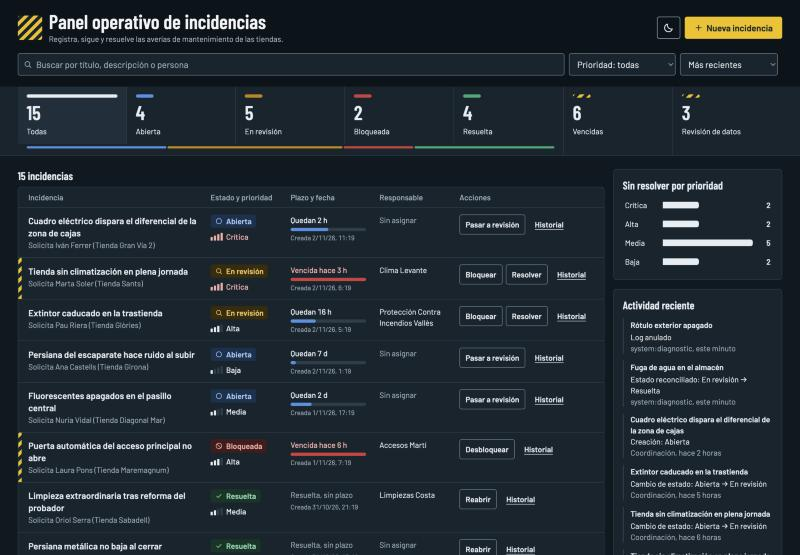
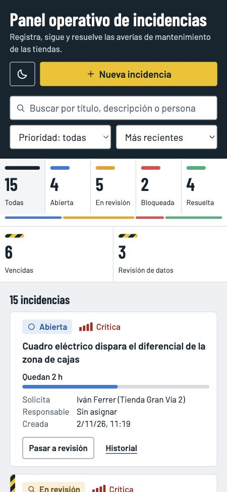
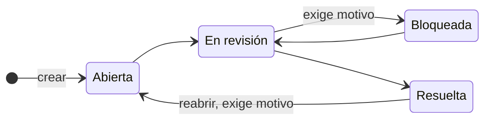
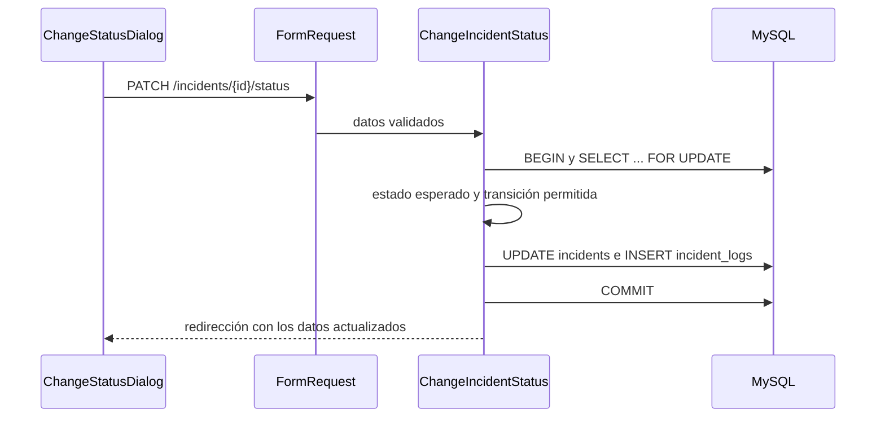

# Panel operativo de incidencias

Cuadro de mando para registrar, priorizar y resolver averías de mantenimiento en tiendas, con trazabilidad completa de cada cambio y un diagnóstico que detecta y corrige de forma segura las inconsistencias de datos.

**Laravel 13 · MySQL 8 · Inertia + React · Tailwind CSS 4**


<details>
<summary>Tema oscuro y versión móvil</summary>





</details>

He entendido esta prueba como un ejercicio de criterio más que de volumen. Por eso he dedicado el esfuerzo a lo que de verdad falla en un sistema así: que el estado y su historial no se separen nunca, que un operador no pueda actuar sobre datos obsoletos y que, cuando los datos ya estén mal, la corrección no empeore las cosas.

**Contenido:** [Puesta en marcha](#puesta-en-marcha) · [Qué hace](#qué-hace) · [Cómo está construido](#cómo-está-construido) · [Decisiones técnicas](#decisiones-técnicas) · [Seguridad](#seguridad) · [Diagnóstico de datos](#diagnóstico-de-datos) · [Calidad](#calidad-y-verificación) · [Requisitos](#mapa-de-requisitos) · [Cómo seguiría](#límites-y-cómo-seguiría) · [Uso de IA](#uso-de-ia)

## Puesta en marcha

| Herramienta | Versión mínima | Probado con | Por qué |
|---|---|---|---|
| PHP | 8.3 | 8.5.12 | Lo exige Laravel 13. Necesita la extensión `pdo_mysql`. |
| Composer | 2 | 2.11.1 | |
| Node y npm | 20.19 o 22.12 | Node 24.16 | Lo exige Vite 8. |
| MySQL | 8.0.16 | 8.4.13 | Funciones de ventana y `CHECK` aplicados. |

En macOS se instalan con `brew install php composer node mysql@8.4`, y MySQL se arranca con `brew services start mysql@8.4`. Esa versión no se añade al `PATH`: su cliente está en `$(brew --prefix mysql@8.4)/bin/mysql`.

**1. Instalar**

```bash
git clone https://github.com/mikexarau/panel-operativo-incidencias.git
cd panel-operativo-incidencias
composer install
npm ci
cp .env.example .env
php artisan key:generate
```

`.env.example` apunta a MySQL en `127.0.0.1:3306`, con usuario `root`, sin contraseña y con la base `incidents`. Si tu instalación es distinta, ajusta los valores `DB_*` en `.env`.

**2. Crear las bases de datos, migrar y cargar los datos de ejemplo**

```bash
mysql -u root -e "CREATE DATABASE incidents CHARACTER SET utf8mb4 COLLATE utf8mb4_unicode_ci; CREATE DATABASE incidents_test CHARACTER SET utf8mb4 COLLATE utf8mb4_unicode_ci;"
php artisan migrate --seed
```

Crea 15 incidencias: 10 sanas y 5 con [inconsistencias simuladas](#inconsistencias-simuladas). Para volver a este estado en cualquier momento: `php artisan migrate:fresh --seed`.

**3. Levantar la aplicación**

```bash
npm run build
php artisan serve
```

Abre <http://127.0.0.1:8000>. `npm run build` necesita internet la primera vez porque descarga las fuentes tipográficas. Para desarrollar con recarga automática, `composer run dev` sustituye a los dos comandos.

> **Si la pantalla sale en blanco:** al cortar `composer run dev` a la fuerza puede quedar el archivo `public/hot`, que apunta a un Vite ya apagado. Bórralo con `rm public/hot`.

**Usuario de prueba:** no hay. La autenticación no es obligatoria en la prueba y no la he implementado. Cada formulario pide "Tu nombre", que queda registrado en el historial y se recuerda en el navegador.

**4. Ejecutar el diagnóstico de inconsistencias**

```bash
php artisan incidents:diagnose
```

No modifica nada: es una simulación. El detalle está en [Diagnóstico de datos](#diagnóstico-de-datos).

## Qué hace

- **Cuadro de estado.** Cada cifra es también un filtro, y debajo se ve el reparto por estado. Los avisos de vencidas y de revisión de datos se encienden cuando hay alguna.
- **Listado con plazos.** Cada incidencia muestra el tiempo restante con un medidor. Una banda de peligro marca de un vistazo lo vencido o bloqueado. Es una tabla en escritorio y tarjetas en móvil.
- **Filtros sin recarga.** Por estado, prioridad y texto libre, con orden por fecha o por urgencia. Se pueden combinar y la URL se puede compartir.
- **Carga y actividad.** Incidencias sin resolver por prioridad y últimos cambios de todo el sistema.
- **Cambios de estado con confirmación.** Bloquear y reabrir exigen motivo, y cada cambio queda en el historial con valor anterior, valor nuevo, actor y fecha.
- **Detalle de cada incidencia.** Historial, comentarios operativos y revisiones de datos pendientes.
- **Tema claro y oscuro,** que sigue la preferencia del sistema y se puede cambiar.

## Cómo está construido



Cada escritura sigue el mismo recorrido, y la parte que importa es indivisible:



| Capa | Dónde | Responsabilidad |
|---|---|---|
| Dominio | `app/Enums` | Única definición de estados, prioridades, transiciones y plazos |
| Escrituras | `app/Actions/Incidents` | Transacción, bloqueo de fila y escritura del log |
| Lecturas | `app/Queries/IncidentDashboard.php` | Listado, indicadores y actividad de la pantalla |
| Entrada | `app/Http/Requests` | Validación y mensajes en español |
| Salida | `app/Http/Resources` | Lo que recibe el frontend, incluidas las transiciones permitidas |
| Mantenimiento | `app/Diagnostics` y `app/Console/Commands` | Detección, corrección y revisión manual |
| Interfaz | `resources/js` | Una pantalla compuesta de componentes pequeños: el mayor no pasa de 130 líneas |

### Frontend: estado, acciones y refresco

| Pregunta | Respuesta |
|---|---|
| ¿Dónde vive el estado? | Los datos, en el servidor. Los filtros y la incidencia abierta, en la URL (`?status=&priority=&q=&flag=&sort=&incident=`). En React solo vive qué diálogo está abierto (`Pages/Incidents/Index.jsx`), el texto mientras se escribe, el tema y el nombre del operador. |
| ¿Dónde se dispara la acción? | La navegación, solo en `lib/incidentNavigation.js`. Las escrituras, en los formularios con `useForm` (`ChangeStatusDialog`, `CreateIncidentDialog`, `CommentSection`). |
| ¿Cómo se refresca? | Al filtrar, Inertia recarga solo el listado y sus indicadores, sin recargar la página y manteniendo la vista anterior atenuada para que no haya saltos. Al abrir una incidencia, solo `selectedIncident`. Tras escribir, el servidor redirige de vuelta y llegan todas las props actualizadas. |

Las transiciones y los plazos llegan calculados del backend: la máquina de estados no se duplica en JavaScript ni depende del reloj del navegador.

### Diseño

El vocabulario visual sale del propio dominio: azul de ropa de trabajo, gris hormigón y amarillo de señalización. El amarillo se reserva para la acción principal y para la banda de peligro de lo que requiere atención, y el cuadro de estado se inspira en los paneles de alarmas de una instalación. Tipografía Barlow, derivada de la rotulación de carreteras. Los colores son tokens en `resources/css/app.css`, y el tema oscuro solo los redefine.

## Decisiones técnicas

| Decisión | Por qué | Alternativa descartada |
|---|---|---|
| **Inertia + React** | El ejercicio 4 lo pide por nombre y deja explícito dónde vive el estado | Livewire: menos JavaScript, pero el estado queda repartido en el servidor |
| **Estados como enum de PHP** con `string` y `CHECK` | Una sola definición, sin strings dispersos, y la base de datos sigue rechazando valores inválidos | `ENUM` de MySQL: añadir un estado obliga a reescribir la tabla |
| **`old_value` y `new_value` sin `CHECK`** | Un log conserva lo que ocurrió, aunque sea incoherente, para poder detectarlo | Validarlos: ocultaría justo lo que hay que diagnosticar |
| **Transacción, `lockForUpdate` y `expected_status`** | Estado y log no pueden separarse, y un operador no puede decidir sobre un estado que otro ya cambió | Solo transacción: no evita decidir con datos antiguos |
| **Claves foráneas `restrict`** | Borrar una incidencia no puede borrar su trazabilidad | `cascade`: cómodo, pero destruye el historial |
| **Logs inmutables, que se anulan y no se borran** | El historial es una evidencia. Un duplicado se marca con `voided_at` y se añade una entrada que lo explica | Borrar la copia: no quedaría rastro de la corrección |
| **Plazo derivado de la prioridad** | El esquema mínimo no tiene fecha límite, y así no hay un campo más que mantener coherente | Columna `due_at`: da más control, pero amplía el esquema sin necesidad |
| **Índices comprobados con `EXPLAIN`** | `(status, created_at)`, `(priority, created_at)` y `(created_at)` para el listado, siempre ordenado por fecha. Un primer índice `(status, priority, created_at)` provocaba `filesort` al filtrar solo por estado | Indexar por intuición |
| **`LIKE` con comodines escapados** | Predecible y encuentra palabras parciales. No usa índice, lo que es aceptable a este volumen | `FULLTEXT`: es la evolución natural si crecen los datos |
| **Sin `users`, `cache` ni `jobs`** | `migrate` crea solo las tablas de la prueba, y sesión y caché usan `file` | Dejar el esqueleto completo sin usarlo |

### Ambigüedades del enunciado

| Punto | Cómo lo he resuelto |
|---|---|
| `bloqueada` no tiene salida en las transiciones mínimas, y sería un estado sin retorno | Añado `bloqueada → en revisión`. No permito pasar directamente a resuelta: debe revisarse antes. |
| "Resuelta no debería volver a abierta sin log explícito" | `resuelta → abierta` registra la acción propia `reopened` y exige motivo. Bloquear también lo exige. |
| "Vencidas" no tiene campo en el esquema mínimo | Se deriva de la prioridad: crítica 4 h, alta 24 h, media 72 h y baja 168 h. Los plazos son una suposición mía, editable en `IncidentPriority::slaHours()`. |
| `user_name` sin autenticación | El operador se declara en cada formulario y el backend lo valida. No es fiable por definición: en producción saldría de `auth()->user()`. |
| `assigned_to` y "claves foráneas donde corresponda" | Es un nombre libre: no hay tabla de usuarios a la que apuntar. |
| Estados en español en el enunciado y esquema en inglés | Valores internos en inglés (`in_review`) y etiquetas en español, ambos en el enum. |

El nombre del operador se pide dentro de cada formulario y no en la cabecera porque un `<dialog>` modal deja inerte el resto de la página y no se podría corregir sin cancelar.

## Seguridad

| Riesgo | Medida |
|---|---|
| Inyección SQL | Valores enlazados. El único SQL interpolado usa constantes de los enums, nunca entrada de usuario. Los comodines de `LIKE` se escapan. |
| XSS | React escapa el contenido, no hay `dangerouslySetInnerHTML` y la CSP prohíbe los scripts en línea. |
| CSRF | Middleware de Laravel, con el token que Inertia gestiona por cookie. |
| Asignación masiva | `$fillable` explícito y datos validados. El cliente no puede fijar el estado inicial. |
| Suplantación del sistema | Los nombres que empiezan por `system:` están reservados: nadie puede falsificar una corrección del diagnóstico. |
| Abuso sin autenticación | Límite de 60 escrituras por minuto e IP. |
| Clickjacking y otros | `X-Frame-Options`, `frame-ancestors`, `X-Content-Type-Options`, `Referrer-Policy` y `Permissions-Policy`. |
| Secretos | `.env` fuera del repositorio y `.env.example` sin credenciales reales. Historial revisado en busca de secretos, y `composer audit` y `npm audit` sin vulnerabilidades. |

**Antes de un despliegue real:** autenticación y autorización (fuera de alcance por el §11), `APP_DEBUG=false` y HTTPS con `SESSION_SECURE_COOKIE=true`.

## Diagnóstico de datos

El comando no modifica nada por defecto: es una simulación que muestra qué se corregiría.

```bash
php artisan incidents:diagnose
```

Resultado con los datos de ejemplo, resumido:

| Incidencia | Regla | Tratamiento | Acción propuesta |
|---|---|---|---|
| 11 | `resolved_without_log` | Automático | Añadir log `status_reconciled` |
| 12 | `status_log_mismatch` | Manual | Una persona decide si manda el estado o el log |
| 13 | `duplicate_log` | Automático | Anular la copia y conservar el original |
| 14 | `duplicate_log` | Manual | Misma transición, pero con otro actor y horas después |
| 15 | `incoherent_log` | Manual | Los datos no permiten deducir qué ocurrió |

Para aplicar las correcciones seguras y registrar el resto para revisión manual. Pide confirmación, salvo que se añada `--force`:

```bash
php artisan incidents:diagnose --fix
```

Con los datos de ejemplo corrige 2 casos y marca 3. Volver a ejecutarlo no cambia nada. Las incidencias marcadas muestran "Revisión de datos" en el panel y el motivo en su detalle.

Las revisiones manuales se cierran con la decisión de una persona, que queda en el historial:

```bash
php artisan incidents:resolve-issue 1 --decision=adopt-log --actor="Responsable de calidad" --reason="Confirmado con la tienda"
```

| Decisión | Efecto | Reglas |
|---|---|---|
| `keep-status` | La incidencia tiene razón: añade un log que recoge su estado | `resolved_without_log`, `status_log_mismatch` |
| `adopt-log` | El último log tiene razón: la incidencia adopta su valor | `resolved_without_log`, `status_log_mismatch` |
| `void-log` | El log es erróneo: lo anula sin borrarlo | `duplicate_log`, `incoherent_log` |
| `accept` | Anomalía histórica conocida: se conserva y deja de reportarse | `duplicate_log`, `incoherent_log` |

El código de salida es `0` si no queda nada pendiente y `1` si quedan hallazgos, de modo que se puede vigilar desde una tarea programada. En producción, antes de `--fix`, conviene hacer una copia de seguridad con `mysqldump`.

### Inconsistencias simuladas

`database/seeders/InconsistentIncidentSeeder.php` las inserta con `DB::table`, saltándose el dominio, como ocurriría con un `UPDATE` manual, una importación o código antiguo sin transacción.

| # | Incidencia | Qué tiene mal | Tratamiento | Por qué |
|---|---|---|---|---|
| 1 | Fuga de agua en el almacén | Resuelta sin ningún log de resolución | **Crea un log compensatorio** | Nada contradice el estado; solo falta la traza. |
| 2 | Cámara frigorífica con alarma | Bloqueada, pero su último log dice resuelta | **Revisión manual** | Dos fuentes se contradicen. Elegir mal reabriría o cerraría una incidencia real. |
| 3 | Rótulo exterior apagado | La misma transición dos veces, mismo operador, 2 segundos | **Anula la copia** | Es un doble envío evidente y no se pierde información. |
| 4 | Central de incendios | La misma transición dos veces, otra persona, 3 horas | **Revisión manual** | Parece un duplicado, pero puede ser otra acción real. |
| 5 | Persiana metálica | Salta de abierta a resuelta | **Revisión manual** | No se puede saber qué pasó en medio, e inventar pasos falsearía el historial. |

Principios de la corrección:

- **`incidents.status` nunca cambia automáticamente.** El estado dirige la operación real, como enviar a un técnico. Solo lo cambia una persona con `adopt-log`.
- **No se borra ni se reescribe.** Solo se añaden logs. Un duplicado se marca con `voided_at`, se añade una entrada `log_voided` y el historial lo muestra tachado.
- **No se inventan datos.** El log reconstruido usa el actor `system:diagnostic`, su `created_at` es el momento real de la corrección y la hora estimada del suceso va en `metadata.estimated_occurred_at`, sin antedatar nada.
- **Cada corrección es auditable.** Lleva un `run_id` en `metadata`, y cada hallazgo se aplica en su propia transacción, revalidando los datos bajo bloqueo.
- **La cola de revisión no se queda desfasada.** Si un problema desaparece, por ejemplo porque alguien corrige el dato, el siguiente `--fix` cierra su revisión con `no-longer-detected`.

### Consultas de detección

Están en `app/Diagnostics/IncidentConsistencyChecker.php`, un método por regla. Este es el SQL que ejecuta, con los valores de los enums ya resueltos, y se puede lanzar tal cual en un cliente de MySQL.

#### 1. `resolved_without_log`: resuelta sin log de resolución

```sql
WITH last_status_log AS (
    SELECT l.id, l.incident_id, l.new_value, l.created_at,
           ROW_NUMBER() OVER (PARTITION BY l.incident_id ORDER BY l.created_at DESC, l.id DESC) AS recency
    FROM incident_logs l
    WHERE l.action IN ('created', 'status_changed', 'reopened', 'status_reconciled') AND l.voided_at IS NULL
)
SELECT i.id AS incident_id, i.updated_at,
       last_log.id AS last_log_id, last_log.new_value AS last_new_value, last_log.created_at AS last_log_at
FROM incidents i
LEFT JOIN last_status_log last_log ON last_log.incident_id = i.id AND last_log.recency = 1
WHERE i.status = 'resolved'
  AND NOT EXISTS (
      SELECT 1 FROM incident_logs r
      WHERE r.incident_id = i.id
        AND r.action IN ('created', 'status_changed', 'reopened', 'status_reconciled')
        AND r.new_value = 'resolved'
        AND r.voided_at IS NULL
  );
```

**Por qué lo detecta:** el `NOT EXISTS` encuentra incidencias resueltas sin ningún log vigente que las llevara a ese estado. El último log se usa como evidencia: si es posterior a `updated_at`, contradice el estado en lugar de faltar una traza, y el caso pasa a revisión manual.

#### 2. `status_log_mismatch`: el estado no coincide con su último log

```sql
WITH last_status_log AS (
    SELECT l.id, l.incident_id, l.new_value, l.created_at,
           ROW_NUMBER() OVER (PARTITION BY l.incident_id ORDER BY l.created_at DESC, l.id DESC) AS recency
    FROM incident_logs l
    WHERE l.action IN ('created', 'status_changed', 'reopened', 'status_reconciled') AND l.voided_at IS NULL
)
SELECT i.id AS incident_id, i.status, i.updated_at,
       last_log.id AS last_log_id, last_log.new_value AS last_new_value, last_log.created_at AS last_log_at
FROM incidents i
LEFT JOIN last_status_log last_log ON last_log.incident_id = i.id AND last_log.recency = 1
WHERE NOT (last_log.new_value <=> i.status)
  AND NOT (i.status = 'resolved' AND NOT EXISTS (
      SELECT 1 FROM incident_logs r
      WHERE r.incident_id = i.id
        AND r.action IN ('created', 'status_changed', 'reopened', 'status_reconciled')
        AND r.new_value = 'resolved'
        AND r.voided_at IS NULL
  ));
```

**Por qué lo detecta:** `ROW_NUMBER` localiza el último log de estado vigente y se compara con la incidencia. `<=>` es la comparación segura con nulos, así que también detecta incidencias sin ningún log. La segunda condición excluye los casos de la regla 1 para no informar dos veces del mismo problema.

#### 3. `duplicate_log`: log duplicado

```sql
WITH ordered AS (
    SELECT l.id, l.incident_id, l.action, l.old_value, l.new_value, l.user_name, l.created_at,
           LAG(l.id) OVER w AS prev_id,
           LAG(l.action) OVER w AS prev_action,
           LAG(l.old_value) OVER w AS prev_old,
           LAG(l.new_value) OVER w AS prev_new,
           LAG(l.user_name) OVER w AS prev_user,
           LAG(l.created_at) OVER w AS prev_at
    FROM incident_logs l
    WHERE l.action IN ('created', 'status_changed', 'reopened', 'status_reconciled') AND l.voided_at IS NULL
    WINDOW w AS (PARTITION BY l.incident_id ORDER BY l.created_at, l.id)
)
SELECT id, incident_id, old_value, new_value, user_name, prev_id, prev_user,
       TIMESTAMPDIFF(SECOND, prev_at, created_at) AS seconds_apart
FROM ordered
WHERE action <=> prev_action AND old_value <=> prev_old AND new_value <=> prev_new;
```

**Por qué lo detecta:** tras un `abierta → en revisión`, otro log idéntico consecutivo es imposible en un flujo normal, porque la incidencia ya no está abierta. Solo se anula automáticamente con el mismo actor y una separación de 5 segundos o menos (`DOUBLE_SUBMIT_SECONDS`).

#### 4. `incoherent_log`: log incoherente

```sql
WITH ordered AS (
    SELECT l.id, l.incident_id, l.action, l.old_value, l.new_value, l.user_name, l.created_at,
           LAG(l.id) OVER w AS prev_id,
           LAG(l.action) OVER w AS prev_action,
           LAG(l.old_value) OVER w AS prev_old,
           LAG(l.new_value) OVER w AS prev_new,
           LAG(l.user_name) OVER w AS prev_user,
           LAG(l.created_at) OVER w AS prev_at
    FROM incident_logs l
    WHERE l.action IN ('created', 'status_changed', 'reopened', 'status_reconciled') AND l.voided_at IS NULL
    WINDOW w AS (PARTITION BY l.incident_id ORDER BY l.created_at, l.id)
)
SELECT id, incident_id, action, old_value, new_value, prev_id, prev_new,
       CASE
           WHEN new_value IS NULL OR new_value NOT IN ('open', 'in_review', 'blocked', 'resolved') THEN 'value_out_of_catalog'
           WHEN old_value <=> new_value THEN 'no_op'
           WHEN action = 'status_changed' AND old_value = 'resolved' AND new_value = 'open' THEN 'implicit_reopen'
           WHEN action <> 'created' AND (COALESCE(old_value, ''), new_value) NOT IN (('open', 'in_review'), ('in_review', 'blocked'), ('in_review', 'resolved'), ('blocked', 'in_review'), ('resolved', 'open')) THEN 'forbidden_transition'
           WHEN prev_id IS NOT NULL AND NOT (old_value <=> prev_new) THEN 'broken_chain'
       END AS problem
FROM ordered
WHERE action IN ('created', 'status_changed', 'reopened')
  AND NOT (action <=> prev_action AND old_value <=> prev_old AND new_value <=> prev_new)
HAVING problem IS NOT NULL;
```

**Por qué lo detecta:** comprueba cada log contra el catálogo y la máquina de estados, y contra el log anterior: su `old_value` debe coincidir con el `new_value` previo. Detecta valores inválidos, cambios sin efecto, reaperturas sin la acción explícita, transiciones prohibidas y cadenas rotas. Las reconciliaciones quedan fuera porque son compensatorias por definición, y los duplicados ya los informa la regla 3.

## Calidad y verificación

```bash
php artisan test
```

Los tests se ejecutan contra MySQL, en `incidents_test`, porque el diagnóstico usa SQL propio de MySQL 8. La suite es pequeña a propósito (52 casos, 16 de ellos de la matriz de transiciones) y cubre lo que sería caro que fallara:

- La matriz completa de transiciones y el rollback del estado si falla la escritura del log.
- La reapertura con motivo, el rechazo de un estado obsoleto y que los logs no se puedan reescribir ni borrar.
- Filtros, comodines de `LIKE`, orden por urgencia y que el filtro de vencidas coincida con la regla del modelo.
- Que la simulación no escriba nada, y que `--fix` no toque estados, sea idempotente y no dé falsos positivos con datos sanos.
- La protección contra suplantación, el límite de escrituras y las cabeceras de seguridad.

Además, el código pasa Laravel Pint y se ha comprobado:

- **Accesibilidad:** axe-core sin violaciones (reglas WCAG 2.2 AA y buenas prácticas) en la pantalla principal, el panel de detalle y los diálogos con errores, en ambos temas. Contraste AA comprobado para los pares de color de texto, en ambos temas.
- **Daltonismo:** paleta de estados comprobada con un validador de separación de color, en ambos temas. El estado nunca se transmite solo por color: siempre lleva icono y texto.
- **Instalación limpia:** clonado del repositorio público en una carpeta vacía, siguiendo este README al pie de la letra.

## Mapa de requisitos

| Enunciado | Dónde está |
|---|---|
| §3 Pantalla principal | `resources/js/Pages/Incidents/Index.jsx` y `resources/js/Components/incidents/` |
| §3 CSS ordenado | Tokens y clases base en `resources/css/app.css`, y utilidades de Tailwind en los componentes |
| §4 Migraciones, FK e índices | `database/migrations/` |
| §4 Estados centralizados | `app/Enums/IncidentStatus.php` |
| §4 Transiciones coherentes y transacciones | `app/Actions/Incidents/ChangeIncidentStatus.php` |
| §5 Crear con validación | `app/Http/Requests/StoreIncidentRequest.php` y `app/Actions/Incidents/CreateIncident.php` |
| §5 Filtros por estado, prioridad y texto | `app/Http/Requests/ListIncidentsRequest.php` y `Incident::scopeFilter` |
| §5 Historial y comentarios | `app/Http/Resources/IncidentDetailResource.php`, `HistoryTimeline.jsx`, `CommentSection.jsx` |
| §5 Errores claros | `lang/es/validation.php` y `app/Exceptions/InvalidStatusTransition.php` |
| §6 Interacción de frontend | `lib/incidentNavigation.js`, `StatusBoard.jsx`, `ChangeStatusDialog.jsx`, `SlaIndicator.jsx` |
| §7 Datos inconsistentes | `database/seeders/InconsistentIncidentSeeder.php` |
| §7 Detección y corrección | `app/Diagnostics/` y `app/Console/Commands/` |
| §7 Simulación previa | `php artisan incidents:diagnose`, sin `--fix` |
| §8 Uso de IA | [`ai-process/README.md`](ai-process/README.md) |
| §9 `.env.example` sin credenciales | [`.env.example`](.env.example) |

## Límites y cómo seguiría

Siguiendo el §11 no he incluido autenticación, roles, notificaciones, Docker, deploy ni integraciones. Si esto fuera a producción, este sería mi orden:

1. **Autenticación y autorización,** para que el actor deje de ser autodeclarado.
2. **Editar y reasignar incidencias,** con su trazabilidad.
3. **Cerrar las revisiones de datos desde la interfaz,** hoy solo por consola.
4. **Inmutabilidad de los logs en la base de datos.** Hoy la protege el modelo, y un `UPDATE` directo en SQL la salta: precisamente el caso que detecta el diagnóstico.
5. **`FULLTEXT` para la búsqueda** cuando el volumen lo justifique.
6. **Lanzar el diagnóstico de forma programada,** aprovechando su código de salida.

La accesibilidad está comprobada con herramientas automáticas, que solo detectan una parte de los problemas: falta una prueba con lectores de pantalla reales.

## Uso de IA

He usado Claude Code como herramienta de implementación, dirigiendo el proceso por iteraciones. El detalle que pide el §8 (herramientas, prompts, partes generadas, decisiones y errores detectados) está en [`ai-process/README.md`](ai-process/README.md).
